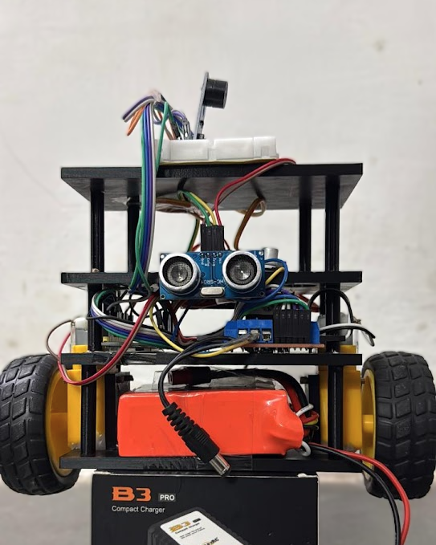
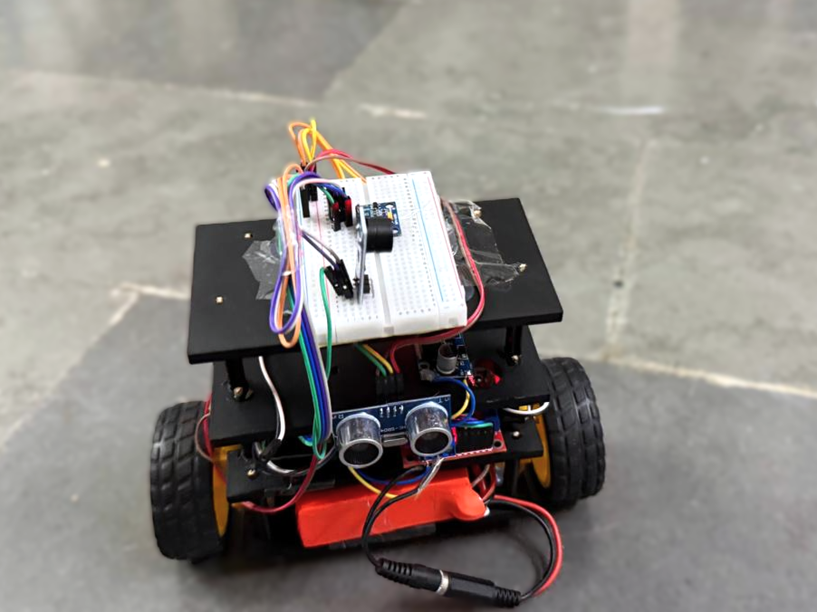
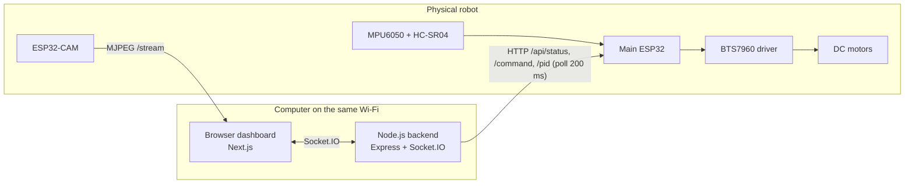
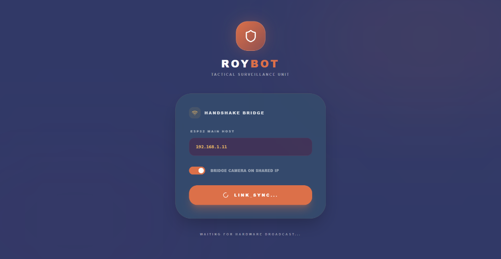
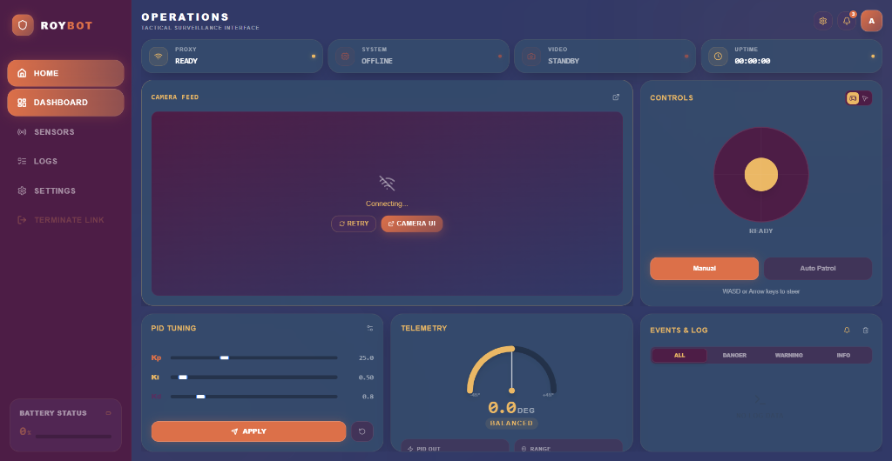

# ROYBOT — ESP32-Based Self-Balancing Surveillance Robot Prototype

**Embedded Systems | Robotics | Electronics | Hardware–Software Integration**

ROYBOT is a student-built, two-wheeled robot prototype. The goal is a robot that balances on two wheels using an IMU, measures distance with an ultrasonic sensor, streams video from an ESP32-CAM, and can be monitored and driven from a web dashboard. The physical robot and its electronics are the core of the project; the backend and dashboard in this repository are the supporting monitoring and control software.

> **Project status (read this first)**
> - The robot is built; photos and a short video are included below.
> - The **web dashboard, backend and ESP32-CAM firmware are in this repository.**
> - The **main ESP32 firmware (balancing, sensors, motors, HTTP API) is not yet in this repository** — `firmware/ROYBOT_Main.ino` is a placeholder that documents the intended pins and API. See [docs/FIRMWARE.md](docs/FIRMWARE.md).
> - No measurements (balancing time, latency, battery life, range) have been recorded yet. Nothing here should be read as a performance claim.
>
> A detailed review is in [docs/AUDIT_REPORT.md](docs/AUDIT_REPORT.md).

## Contents

[Overview](#project-overview) · [Physical robot](#physical-robot) · [Hardware](#hardware-components) · [Architecture](#system-architecture) · [Firmware](#embedded-firmware) · [Dashboard](#web-dashboard) · [AI-assisted development](#ai-assisted-development) · [Structure](#project-structure) · [Setup](#setup) · [Testing](#testing-and-validation) · [Limitations](#known-limitations) · [Future work](#future-improvements) · [Demo](#demo) · [License](#license)

## Project Overview

ROYBOT combines four areas that an electronics and communication engineer works with:

1. **Electronics** – ESP32 boards, an IMU, an ultrasonic sensor, a motor driver, DC motors and a battery, wired on a prototype breadboard.
2. **Embedded firmware** – C++ for the ESP32 (main controller) and ESP32-CAM.
3. **Wireless communication** – Wi-Fi with HTTP between the robot and a computer, Socket.IO between the computer and the browser.
4. **Monitoring and control software** – a Node.js backend and a Next.js web dashboard.

### Objectives

- Build a self-balancing two-wheeled platform controlled by an ESP32.
- Read tilt (MPU6050) and obstacle distance (HC-SR04) and use them for control and alerts.
- Drive DC motors through a BTS7960 driver.
- Stream camera video and show telemetry in a browser.
- Allow manual driving and PID-gain adjustment from the dashboard.

Which of these objectives are implemented and verified is tracked in the [feature inventory](docs/AUDIT_REPORT.md#2-feature-status-inventory).

## Physical Robot

<table>
  <tr>
    <td align="center"></td>
    <td align="center"></td>
  </tr>
  <tr>
    <td align="center">Front: ultrasonic sensor, battery pack, motor-driver board, three-tier chassis</td>
    <td align="center">Rear/top: breadboard wiring, sensor module, two driven wheels</td>
  </tr>
</table>

Photos of the electronics, wiring and power system are still missing (see [docs/HARDWARE.md](docs/HARDWARE.md)).

## Hardware Components

| Component | Purpose | Interface | Status |
|---|---|---|---|
| Main ESP32 | Main controller, Wi-Fi access point, HTTP API | Wi-Fi | Firmware not in repo |
| ESP32-CAM (AI-Thinker, OV2640) | Video stream | Wi-Fi, HTTP MJPEG | Firmware in repo, not tested here |
| MPU6050 | Tilt measurement (accelerometer + gyroscope) | I2C: SDA 21, SCL 22 | Pins from spec; needs verification |
| HC-SR04 / HC-SR04P | Distance measurement | TRIG 5, ECHO 18 | Sensor visible in photos; pins from spec |
| BTS7960 | Motor driver | RPWM 25, LPWM 26, R_EN 32, L_EN 33 | Pins from spec; motor wiring needs verification |
| DC gear motors + wheels | Locomotion | Via driver | Visible in photos |
| Battery pack | Power | — | Visible; type and capacity not documented |
| Buzzer, red/yellow/green LEDs | Alerts / status | GPIO 19; 13, 14, 27 | From spec only |

Full details, evidence levels and open hardware questions: [docs/HARDWARE.md](docs/HARDWARE.md). No wiring diagram exists yet and none has been invented.

## System Architecture



Details, data flows and the interface contract: [docs/ARCHITECTURE.md](docs/ARCHITECTURE.md).

Important deployment note: the robot is meant to create its own Wi-Fi network (`192.168.4.x`). The backend must therefore run on a computer connected to that network; a cloud-hosted backend cannot reach the robot.

## Embedded Firmware

| File | Target | State |
|---|---|---|
| `firmware/ROYBOT_Camera.ino` | ESP32-CAM | Initialises the OV2640 (JPEG, QVGA), joins Wi-Fi, serves an MJPEG stream on `/stream`, a flash-LED route and a restart route |
| `firmware/ROYBOT_Main.ino` | Main ESP32 | **Placeholder** (intended pin map and API only) |

Sensor integration (MPU6050, HC-SR04) and motor control (BTS7960) are described in [docs/FIRMWARE.md](docs/FIRMWARE.md), including general background on how each device works. Their *implementation* cannot be documented until the main sketch is added.

## Web Dashboard

The dashboard (`client/`) is the software interface to the robot. It runs in the browser and talks to the backend over Socket.IO. Implemented in the code:

- Connection form for the robot's and camera's IP addresses (this is not a login).
- Camera view with optional in-browser person/object detection (TensorFlow.js COCO-SSD).
- Drive controls (joystick, buttons, WASD/arrow keys) and Manual/Auto mode buttons.
- PID gain sliders that send values to the robot.
- Telemetry: tilt-angle gauge, distance, PID output, mode, uptime, obstacle/fallen indicators.
- Alert list and a tilt-angle history graph.
- Not functional yet: the Settings page (labelled "UI preview only"), the battery indicator (needs a `battery` value from the robot) and the Logs page ("coming soon").

The screenshots below were taken **without a robot connected** (System: OFFLINE), so they show the interface only:

<table>
  <tr>
    <td></td>
    <td></td>
  </tr>
  <tr>
    <td align="center">Connection screen (IP addresses)</td>
    <td align="center">Main screen, no robot connected</td>
  </tr>
</table>

A hosted copy of the interface is at <https://roybot-server.vercel.app/>. On its own it only shows the interface; it needs the backend and the robot to display data.

## AI-Assisted Development

AI coding assistants were used as a development aid for parts of the software and documentation (for example drafting code and the specification file `ROYBOT_Hardware_Requirements.txt`, which was written as a prompt for such tools). Assembling and wiring the robot, integrating the hardware, and testing and troubleshooting it are done by the developer, not by AI. Generated code is treated as a draft that must be verified on the real hardware; items that have not been verified are marked as such in this repository.

## Project Structure

```
ROYBOT/
├── client/              Next.js dashboard (React, TypeScript, Tailwind CSS)
│   ├── src/app          Pages: /, /sensors, /logs, /settings
│   ├── src/components   UI panels (video, controls, PID, telemetry, alerts)
│   ├── src/hooks        Socket.IO data/command hooks, browser object detection
│   ├── vercel.json      Vercel configuration
│   └── .env.example     NEXT_PUBLIC_SERVER_URL
├── server/              Node.js backend (Express, Socket.IO, Axios)
│   └── src              Routes, ESP32 service, poller, socket handlers, input validation
├── firmware/            Arduino sketches (ROYBOT_Main.ino = placeholder, ROYBOT_Camera.ino)
├── docs/                Architecture, hardware, firmware and audit documents
├── assets/              Photos, dashboard screenshots, demo video
├── .github/workflows/   GitHub Pages workflow (currently non-functional, see audit)
├── .env.example         Backend environment variables
├── ROYBOT_Hardware_Requirements.txt   Intended design / spec written for AI assistants
├── package.json         npm workspace (client + server)
└── LICENSE, CONTRIBUTING.md
```

## Setup

### 1. Hardware preparation and connections
The wiring is not documented in this repository. The intended pin map is in [docs/HARDWARE.md](docs/HARDWARE.md) and must be checked against the real robot. If you use an HC-SR04 (5 V) check the ECHO voltage level before connecting it to the ESP32.

### 2. Firmware
- **ESP32-CAM:** follow "Before flashing" in [docs/FIRMWARE.md](docs/FIRMWARE.md) (board *AI Thinker ESP32-CAM*, add `camera_pins.h`, set your Wi-Fi name and password in the sketch).
- **Main ESP32:** the sketch is not in the repository yet.
- Choose your own Wi-Fi/AP passwords and never commit them.

### 3. Backend
Requires Node.js 20 or newer. Run on a computer connected to the robot's Wi-Fi network.
```bash
npm ci                      # from the repository root (installs client and server)
cp .env.example .env        # optional; defaults: port 3001, poll 200 ms, CORS origin http://localhost:3000
npm run dev -w server       # development
# or: npm run build -w server && npm run start
```

### 4. Dashboard
```bash
cp client/.env.example client/.env.local   # NEXT_PUBLIC_SERVER_URL (default http://localhost:3001)
npm run dev -w client                      # http://localhost:3000
```
`npm run dev` at the root starts both together. Open the dashboard, enter the robot's IP (default `192.168.4.1`) and the camera's IP (default `192.168.4.2`), and connect.

### 5. Operation and troubleshooting
- "System OFFLINE": the backend cannot reach `http://<robot-ip>/api/status` — check that the computer is on the robot's Wi-Fi and that the main firmware serves the API.
- "Video STANDBY" or no snapshots/detection: the backend expects `/status` and `/capture` on the camera, which the current camera sketch does not serve (see [docs/ARCHITECTURE.md](docs/ARCHITECTURE.md#4-interface-contract-and-known-mismatches)). The stream itself is requested directly from `http://<camera-ip>/stream`.
- Sidebar battery shows N/A: the robot does not send a `battery` value.

## Testing and Validation

Levels: *software build* ≠ *simulation* ≠ *physical test*. Only the first two have been performed.

| Test | Status | Evidence / notes |
|---|---|---|
| Server TypeScript build | PASS | `tsc`, audit run |
| Dashboard production build | PASS | `next build`, 7 pages |
| Backend ↔ simulated ESP32 (status proxy, commands, PID, alerts, Socket.IO, input validation) | PASS (simulated) | 16/16 cases against a mock robot; **not hardware** |
| Camera and main firmware compilation | NOT TESTED | Arduino toolchain not available |
| ESP32 boot, Wi-Fi AP | NEEDS PHYSICAL VERIFICATION | — |
| MPU6050 readings | NEEDS PHYSICAL VERIFICATION | — |
| HC-SR04 readings | NEEDS PHYSICAL VERIFICATION | — |
| Motor driver and motor operation | NEEDS PHYSICAL VERIFICATION | — |
| Balancing | NEEDS PHYSICAL VERIFICATION | 5-second clip shows the robot upright; no data recorded |
| Camera stream and dashboard video | NEEDS PHYSICAL VERIFICATION | — |
| End-to-end dashboard control of the robot | NEEDS PHYSICAL VERIFICATION | Main firmware not in repo |

## Known Limitations

- Main ESP32 firmware is missing from the repository; balancing and sensor behaviour are unverified.
- No quantitative results (stability, response time, latency, battery life, Wi-Fi range).
- Prototype breadboard wiring; motor-driver arrangement and power path are not documented.
- Camera sketch and backend disagree on endpoints; the camera stream blocks other camera requests while open.
- No authentication on the robot, camera or backend: use only on a trusted network and do not expose the backend to the internet.
- A cloud-hosted dashboard/backend cannot reach the robot's private network; an HTTPS-hosted dashboard loading an HTTP camera stream may be blocked by the browser (not tested).
- `npm audit` reports dependency advisories that have not been updated yet.
- No automated tests.

## Future Improvements

*(Ideas, not implemented.)*

- Add the main firmware, a wiring diagram and electronics photos.
- Record test data: tilt angle and PID output while balancing, battery voltage, response time.
- Align the camera firmware with the backend (`/capture`, `/status`, non-blocking stream).
- Add a motor safety timeout (stop if no command or telemetry arrives) and a fall cut-off.
- Report battery voltage from the robot.
- Authentication for the control interface; update dependencies.

## Demo

[](assets/videos/roybot-demo.mp4)

Click the image to open the 5-second clip (`assets/videos/roybot-demo.mp4`). It shows the physical robot upright on two wheels; it does not show the dashboard or any measurements.

## License

MIT — see [LICENSE](LICENSE).
